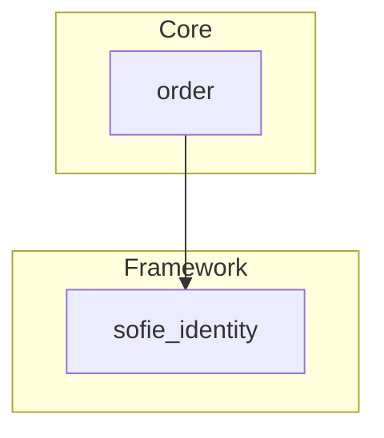

<!-- @generated by `sofie docs`; do not edit. -->

# Architecture

## Modules

| Module | Tier | Context | Contract |
| --- | --- | --- | --- |
| [order](modules/order.md) | Core | `commerce` | `order_contract` |

Dependencies flow downward: Experience → Core → Platform.

## Areas

| Area | Prefix | Principal | Defined by | Modules routing in |
| --- | --- | --- | --- | --- |
| `web` | — | `Visitor` | the framework | — |
| `customer` | `/account` | `Account` | `order_contract` | `order` |

## Contracts

| Contract | Areas | Events | Generated exports | Implemented traits |
| --- | --- | --- | --- | --- |
| `order_contract` | `customer` | `OrderPlaced (1 listening)`, `OrderCancelled (1 listening)` | `pruned`, `routes` | — |
