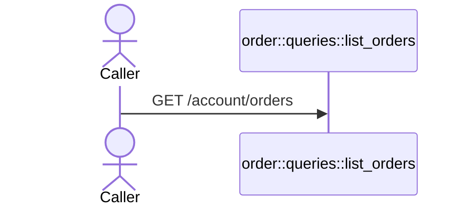
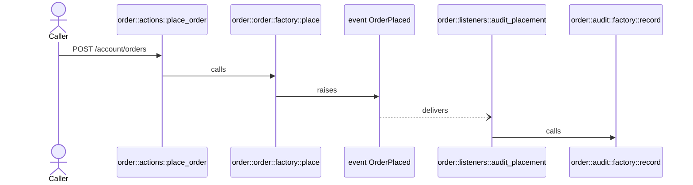
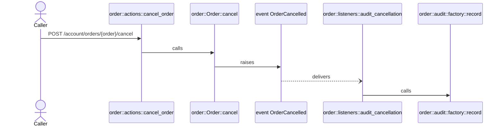
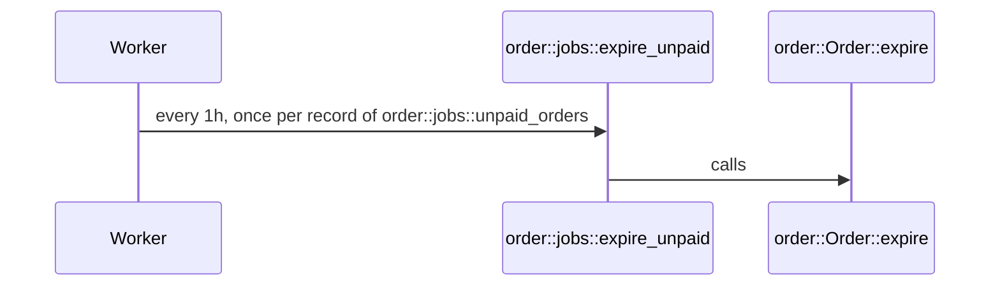

<!-- @generated by `sofie docs`; do not edit. -->

# Request flows

Each endpoint and schedule followed through the functions and aggregate methods it calls, the events raised, their listeners and the jobs queued. Branches are not drawn: a flow shows what can happen, not under which condition. Edges the model cannot follow are listed below each diagram.

## `order.customer.list_orders`

`GET /account/orders`

## `order.customer.place_order`

`POST /account/orders`

The order is sent to the email the customer's account has now.

## `order.customer.cancel_order`

`POST /account/orders/{order}/cancel`

## `order::jobs::expire_unpaid`

`every 1h, once per record of order::jobs::unpaid_orders`

