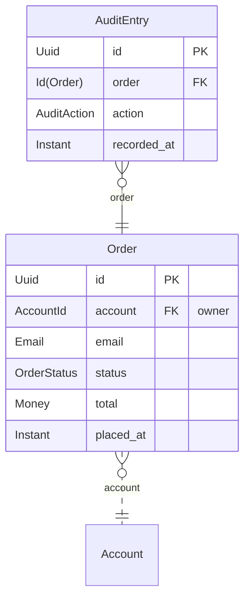
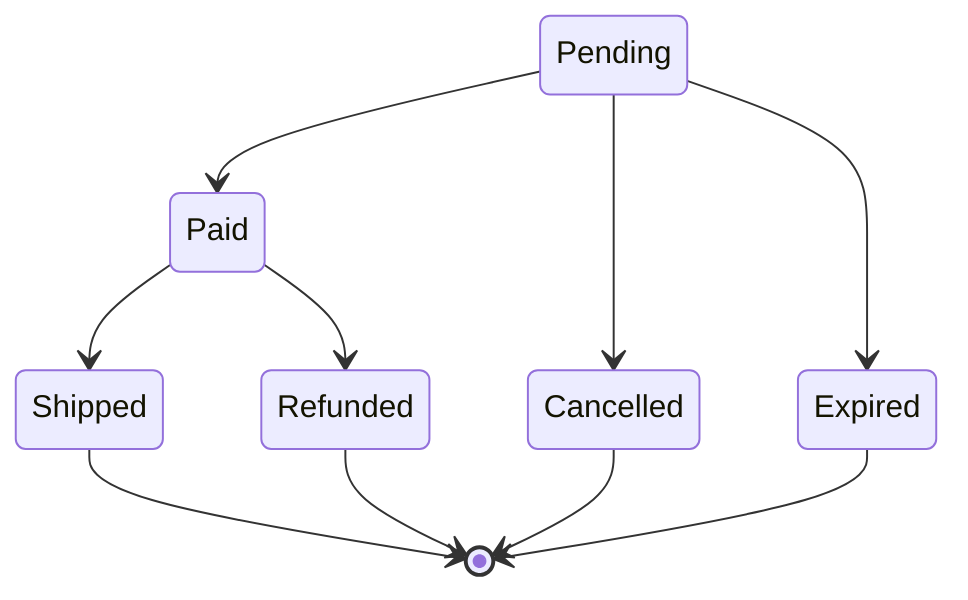

<!-- @generated by `sofie docs`; do not edit. -->

# Module `order`

- Tier: Core
- Context: `commerce`
- Contract: `order_contract`
- Migrations: 6

## Areas and routes

### Area `customer`

Prefix `/account`, principal `Account`, reaching principal's own records.

| Method | Path | Name | Handler | Description | Permission | Feature, modifiers |
| --- | --- | --- | --- | --- | --- | --- |
| GET | `/account/orders` | `order.customer.list_orders` | `order::queries::list_orders` | — | — | `screen(orders)` |
| POST | `/account/orders` | `order.customer.place_order` | `order::actions::place_order` | The order is sent to the email the customer's account has now. | — | `then_screen(orders#orders)` |
| POST | `/account/orders/{order}/cancel` | `order.customer.cancel_order` | `order::actions::cancel_order` | — | — | `then_screen(orders#orders)` |

Screens: `order/customer/orders`

## Data model

### AuditEntry

What happened to an order, recorded by the listeners as it happened.

- Behaviors: `Versioned`, `Timestamps`
- Owner: —
- Exposed to other modules: —
- Columns: `order`, `action`, `recorded_at`, `version`, `created_at`, `updated_at`

| Field | Type | Constraints |
| --- | --- | --- |
| `order` | `Id<Order>` | — |
| `action` | `AuditAction` | — |
| `recorded_at` | `Instant` | — |

### Order

- Behaviors: `Versioned`, `Timestamps`
- Owner: `account`
- Exposed to other modules: —
- Columns: `account`, `email`, `status`, `total`, `placed_at`, `version`, `created_at`, `updated_at`

| Field | Type | Constraints |
| --- | --- | --- |
| `account` | `AccountId` | — |
| `email` | `Email` | — |
| `status` | `OrderStatus` | — |
| `total` | `Money` | — |
| `placed_at` | `Instant` | — |

## State machines

### OrderStatus

## Read models

| Read model | Reads from | Fields |
| --- | --- | --- |
| `OrderRow` | `Order` | `id: Id<Order>`, `status: OrderStatus`, `total: Money` |

## Inputs

| Input | Constraints from | Fields |
| --- | --- | --- |
| `PlaceOrder` | — | `total: Money` |

## Events

| Event | Raised by | Heard by |
| --- | --- | --- |
| `OrderPlaced` | `order::order::factory::place` | `order::listeners::audit_placement` |
| `OrderCancelled` | `order::Order::cancel` | `order::listeners::audit_cancellation` |

## Jobs and schedules

| Job | Runs | Feature |
| --- | --- | --- |
| `order.jobs.expire_unpaid` | every 1h, once per record of `jobs::unpaid_orders` | — |

Request flows through this module are drawn in [flows](../flows.md).
