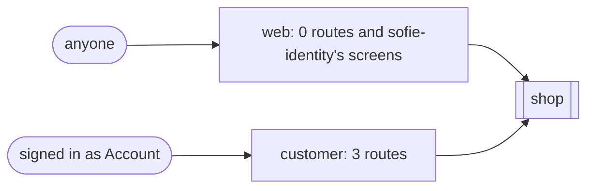

<!-- @generated by `sofie docs`; do not edit. -->

# Security surface

Who reaches what, read from the routes, areas, gateways and config. Fields logged only as their mask are listed in [telemetry](telemetry.md#masked-fields).

## Routes

| Method | Path | Area | Access | Permission | Owner scope | Rate limit | Checks |
| --- | --- | --- | --- | --- | --- | --- | --- |
| GET | `/account/orders` | `customer` | signed in as `Account` | — | principal's own | — | — |
| POST | `/account/orders` | `customer` | signed in as `Account` | — | principal's own | — | same origin (CSRF) |
| POST | `/account/orders/{order}/cancel` | `customer` | signed in as `Account` | — | principal's own | — | same origin (CSRF) |

## Public endpoints

- sofie-identity's screens: `sofie_identity/web/ask_sign_in_link`, `sofie_identity/web/ask_verification`, `sofie_identity/web/forgot_password`, `sofie_identity/web/join`, `sofie_identity/web/link_sent`, `sofie_identity/web/oauth_return`, `sofie_identity/web/reset_password`, `sofie_identity/web/second_factor`, `sofie_identity/web/sign_in`, `sofie_identity/web/sign_in_link`, `sofie_identity/web/sign_up`, `sofie_identity/web/verify_email`
- `/live`: answers once the process serves
- `/ready`: names a dependency that is down, never why; telemetry outages answer 200 degraded
- `/metrics`: feature `metrics`: only with `Authorization: Bearer` and `SOFIE_METRICS_TOKEN`; absent without the token
- `/_sofie/telemetry`: feature `browser-telemetry`: 60 posts a minute per address, a kind, a listed name and a number only

## Outgoing requests

None: no gateway or split module sends requests.

## Secrets

Never logged or printed; set them only in the environment.

| Key | Read by | Description |
| --- | --- | --- |
| `DATABASE_URL` | the framework | The app's database, and every module's that sets none of its own. |
| `SOFIE_SIGNING_KEYS` | the framework | Comma-separated base64 keys of 32 bytes sealing sessions and signing links; the first seals. Read as `SOFIE_SESSION_KEYS` too, with a warning. |
| `SOFIE_METRICS_TOKEN` | the framework | With the `metrics` feature: the bearer token, at least 32 characters, that `/metrics` asks for; without it `/metrics` does not exist. |
| `SOFIE_REDIS_URL` | the framework | With `SOFIE_CACHE_STORE=redis`: `redis://[user:password@]host[:port][/database]`, or `rediss://` for TLS. |
| `SOFIE_SEARCH_MEILISEARCH_API_KEY` | the framework | With `SOFIE_SEARCH=meilisearch`: the key Meilisearch asks for, allowed to search and to write documents and settings; none when unset. |
| `SOFIE_STORAGE_S3_SECRET_ACCESS_KEY` | the framework | With `SOFIE_STORAGE=s3`: the access key's secret. |
| `SOFIE_BILLING_API_KEY` | the framework | With `SOFIE_BILLING_PROVIDER`: the provider's API key. |
| `SOFIE_BILLING_WEBHOOK_SECRET` | the framework | With `SOFIE_BILLING_PROVIDER`: the secret the provider signs its webhooks with. |
| `SOFIE_NOTIFY_VAPID_PRIVATE_KEY` | the framework | With the `notify` feature: the base64url VAPID private key. |

## Not checked here

- Area-wide rate limits (`app.throttle::<A>(…)`), CORS policies and content security sources, set in code the model does not read.
