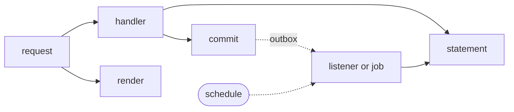

<!-- @generated by `sofie docs`; do not edit. -->

# Telemetry

The framework opens spans and records metrics at every boundary; this page names them for this app. Every log line carries `trace_id`, `span_id`, `request_id`, `module` and `area`.

## Spans

| Span | Kind | Opened for |
| --- | --- | --- |
| `GET order.customer.list_orders` | request | `/account/orders` |
| `order::queries::list_orders` | handler | `order.customer.list_orders` |
| `order/customer/orders` | render | `order.customer.list_orders` |
| `POST order.customer.place_order` | request | `/account/orders` |
| `order::actions::place_order` | handler | `order.customer.place_order` |
| `POST order.customer.cancel_order` | request | `/account/orders/{order}/cancel` |
| `order::actions::cancel_order` | handler | `order.customer.cancel_order` |
| `listener order.listeners.audit_placement` | message | `OrderPlaced` heard |
| `listener order.listeners.audit_cancellation` | message | `OrderCancelled` heard |
| `job order.jobs.unpaid_orders` | message | every 1h |
| `job order.jobs.expire_unpaid` | message | once per record `jobs::unpaid_orders` lists |
| `statement` | database | each statement, without its bindings |
| `commit` | database | each unit of work's commit |

## Metrics

Behind the `metrics` feature. A label takes only names fixed at compile time, so each is bounded by the values listed.

| Metric | Kind | Labels | Names in this app |
| --- | --- | --- | --- |
| `http.server.request.duration` | duration | `http.route`, `http.request.method`, `http.response.status_code`, `area` | `order.customer.list_orders`, `order.customer.place_order`, `order.customer.cancel_order`, `customer` |
| `sofie.handler.duration` | duration | `code.function.name`, `module` | `order::queries::list_orders`, `order::actions::place_order`, `order::actions::cancel_order`, `order` |
| `db.client.operation.duration` | duration | `db.operation.name` | — |
| `db.client.connection.count` | gauge | — | — |
| `messaging.outbox.depth` | gauge | — | — |
| `messaging.process.lag` | duration | `messaging.work` | — |
| `messaging.process.outcomes` | counter | `messaging.work`, `messaging.name`, `outcome` | `order.listeners.audit_placement`, `order.listeners.audit_cancellation`, `order.jobs.unpaid_orders`, `order.jobs.expire_unpaid` |
| `product.events` | counter | `product.event` | — |
| `sofie.browser.events` | counter | `browser.kind`, `browser.name`, `http.route` | `order.customer.list_orders` |
| `sofie.shield.decisions` | counter | `shield.rule`, `shield.grade` | — |
| `sofie.shield.signals.dropped` | counter | — | — |
| `sofie.metrics.dropped` | counter | — | — |
| `sofie.gateway.duration` | duration | `gateway.vendor`, `gateway.operation`, `outcome` | — |
| `sofie.outgoing.duration` | duration | `gateway.vendor`, `gateway.operation`, `outcome` | — |

## Product events

None: no module calls `product_event!`.

## Masked fields

These fields log only their mask, by their value type or a `#[sensitive]` mark.

| Type | Field | Value type |
| --- | --- | --- |
| `order::Order` | `email` | `Email` |
